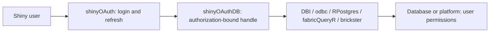

# shinyOAuthDB

Use a Shiny visitor's authorization from **shinyOAuth** with existing R database and data-platform packages. The database or platform enforces that user's grants, roles and data policies.

This development package provides session-owned native connections, native token providers and guarded background tasks. Login, consent and refresh stay in shinyOAuth; queries, polling, pagination and data conversion stay in the existing client packages.



## Installation

This version needs the development **shinyOAuth** checkout with module-managed `access_token()` and token targets. Fabric needs the public `fabric_token_provider()` hook added to the sibling **fabricQueryR** checkout. Databricks needs the external-token hooks in the sibling **brickster** fork. Published versions without these interfaces are reported as unsupported.

Install the relevant CRAN dependencies, then install the local packages from their directories. From this repository:

```sh
R CMD INSTALL ../shinyOAuth
R CMD INSTALL ../fabricQueryR   # for Fabric
R CMD INSTALL ../brickster     # for Databricks
R CMD INSTALL .
```

Only install the client packages for your chosen backend. `mirai` and `future` are optional worker engines; native database drivers must also be installed separately where applicable. See [playground setup](playground/README.md) for configuration.

## Native connections first

Configure a source and its shinyOAuth client outside `server()`. Create one handle for each source inside `server()`:

```r
library(shiny)
library(shinyOAuth)
library(shinyOAuthDB)

source <- oauth_db_azure_sql("example.database.windows.net", "Reporting")
client <- oauth_db_microsoft_client(
  source, tenant_id = Sys.getenv("OAUTHDB_TENANT_ID"),
  client_id = Sys.getenv("OAUTHDB_CLIENT_ID"),
  client_secret = Sys.getenv("OAUTHDB_CLIENT_SECRET"),
  redirect_uri = "http://localhost:8100"
)

ui <- oauth_ui(fluidPage(
  actionButton("login", "Sign in"),
  actionButton("logout", "Sign out"),
  actionButton("load", "Load data"),
  tableOutput("rows")
), id = "auth", client = client)

server <- function(input, output, session) {
  auth <- oauth_module_server("auth", client, auto_redirect = FALSE)
  observeEvent(input$login, auth$request_login())
  observeEvent(input$logout, auth$logout())
  db <- oauth_db_session(source, reactive(auth$connection()))

  rows <- reactive({
    db$generation()
    req(input$load > 0)
    oauth_db_with_connection(db, DBI::dbGetQuery,
      statement = "SELECT TOP (20) name FROM sys.tables")
  })
  output$rows <- renderTable(rows())
}
shinyApp(ui, server, uiPattern = ".*")
```

The handle's `db$connection()` is an ordinary native DBI connection. Use it with DBI, dbplyr and the driver's existing APIs. `oauth_db_with_connection()` provides a synchronous scope that rechecks the authorization before returning materialized data. `connection_policy = "operation"` instead closes each scoped connection after use.

For event-cached application results, clear both saved values and saved errors when `db$generation()` changes; the [playground](playground/shared.R) demonstrates this pattern. Ordinary token rotation leaves the generation unchanged. Raw native connections and application caches retain their native semantics, so arbitrary calls made outside these helpers need application lifecycle handling.

## Choose the authorization connection

The bridge is built around the **authorization connection object**, not the login module itself. Modern `oauth_module_server()` and `oauth_connections_server()` connections work directly. Supply a pinned object, a reactive, or a no-argument accessor:

```r
# Single-module app:
db <- oauth_db_session(source, authorization = auth$connection)

# Multiple authorizations, with a separate app-login module:
# 'databases' is a manager configured with database clients only.
db <- oauth_db_session(source, authorization = function() {
  req(app_login$connection())
  id <- input$database_authorization  # explicitly selected manager ID
  if (is.null(id) || !nzchar(id)) return(NULL)
  databases$connection(id)
})
```

The app-login connection and database connection can have different providers, users and scopes. Only the selected database object supplies database credentials. Changing that selection retires the previous native connection and invalidates saved providers and task outcomes. One handle can follow selection; several handles can independently bind different IDs. A manager with several grants requires an explicit ID; the bridge reports `selection_required` instead of choosing one.

[The multiple-connections playground](playground/example-multiple-connections.R) retains distinct login and database grants in one genuine shinyOAuth manager and has explicit selectors. A standalone session-only login module loses its token on full OAuth callback navigation; using it beside a retained database manager requires the app's persistent login session. See the playground notes for callback routing and owner setup.

Custom provider objects work too. They need `id`, `access_token(required_scopes, min_valid_for, force_refresh, async, target)` and `has_scopes(scopes, target)`; optional `targets()` supports first acquisition of a named target. The class is unrestricted. Use `oauth_db_authorization()` to map another package's methods:

```r
custom <- oauth_db_authorization(
  id = provider_grant_id,
  access_token = my_access_token,  # callback honoring scopes/lifetime/refresh/async
  has_scopes = my_has_scopes      # reactive permission + grant-liveness check
)
db <- oauth_db_session(source, authorization = custom)
```

Keep each object pinned to one authorization, with a new non-secret ID on replacement and reactive notification on logout/permission changes. Callbacks own their provider's login and refresh lifecycle. A named source target must be supported explicitly; callbacks omitting `target` work only with `target = NULL`. Use the modern module factories rather than the legacy `oauth_connection()` wrapper, whose token reactive can follow later logins.

## Existing platform functions

Fabric and Databricks retain their native functions and provider formats:

```r
# Inside server(), using the source appropriate for this service:
kql_source <- oauth_db_fabric("kql",
  cluster = "https://example.kusto.fabric.microsoft.com", database = "Events")
kql <- oauth_db_session(kql_source, reactive(auth$connection()))

fabricQueryR::fabric_kql_query(
  query = "Events | take 10", cluster = kql_source$config$cluster,
  database = kql_source$config$database, token = kql$token_provider()
)

databricks <- oauth_db_session(databricks_source,
  reactive(databricks_auth$connection()))
brickster::db_sql_query(
  host = databricks_source$config$host,
  warehouse_id = databricks_source$config$warehouse_id,
  statement = "SELECT current_user()", token = databricks$token_provider()
)
```

Declare all Microsoft sources when creating their shared client. Compatible sources sharing a target/resource have their scope requirements combined. Each source then selects its own target. Microsoft `.default` and explicit API consent profiles require compatible configuration or separate clients. Native Databricks and native Snowflake OAuth use separate provider clients; optional helpers configure them through shinyOAuth.

## Background tasks

Pass an existing exported function directly. The adapter supplies the source configuration and credentials; invocation arguments supply the operation:

```r
# Outside server(), choose and configure an existing worker engine:
mirai::daemons(2)
# Or: future::plan(future::multisession, workers = 2)

# Inside server():
query <- oauth_db_task(db, DBI::dbGetQuery,
  executor = "mirai", pending = "latest", effect = "read",
  credential_budget = 120)

observeEvent(input$load, query$invoke(
  statement = "SELECT TOP (20) name FROM sys.tables"))
output$rows <- renderTable(query$result())

kql_query <- oauth_db_task(kql, fabricQueryR::fabric_kql_query,
  pending = "latest", effect = "read")
kql_query$invoke(query = "Events | take 10")
```

Tasks capture the authorization when queued and acquire credentials when starting. Workers receive a fixed, short-lived access token and plain configuration; they open their own connection. They receive no session, live OAuth reference, refresh token, client secret or live database connection. Late values and errors are hidden after logout, authorization replacement or observed permission loss.

`pending = "serial"` is the default. `"latest"` replaces waiting reads, while `"ignore"` declines new work while busy. `effect` is declared by the app; SQL text is not classified. `$cancel()` discards local outcomes and pending work; it does not cancel a submitted remote statement or undo a write. Worker errors are sanitized, and a credential budget is a local credential-use limit rather than a remote query timeout.

## Implemented adapters

For a runnable self-hosted PostgreSQL OAuth experiment, use the
[PostgreSQL/Keycloak Docker Compose integration](integration/postgres-keycloak/README.md).
It exercises real browser authorization and PostgreSQL row-level security with
an integration-only RPostgres token hook. This does not add a production generic
PostgreSQL adapter.

All cloud adapters are **experimental pending live acceptance against your deployment**. Offline tests verify routing and lifecycle; cloud user mapping and grants require the opt-in scenarios.

| Backend | Source constructor | Existing client |
|---|---|---|
| Azure SQL | `oauth_db_azure_sql()` | DBI + odbc, explicit Entra token attribute |
| Entra-enabled SQL Server | `oauth_db_sql_server(entra_enabled = TRUE)` | DBI + odbc |
| Azure PostgreSQL Flexible Server | `oauth_db_azure_postgres()` | DBI + RPostgres, Entra token as password |
| Fabric SQL | `oauth_db_fabric_sql()` | fabricQueryR connector + native DBI |
| Fabric discovery, KQL, DAX, GraphQL, OneLake | `oauth_db_fabric(service = ...)` | Existing fabricQueryR functions and endpoint policy |
| Databricks SQL and mapped APIs | `oauth_db_databricks()` | brickster provider, REST and DBI implementation |
| Snowflake native / external OAuth | `oauth_db_snowflake()` | DBI + odbc with explicit OAuth token and role |
| Custom delegated connector | `oauth_db_custom()` | Trusted connector returning native DBI |

An ordinary password/Windows-authenticated on-premises database cannot reuse an OAuth visitor identity through these adapters. Native PostgreSQL OAUTHBEARER, BigQuery and AWS warehouses remain research tracks. There is no automatic service-account, PAT, CLI or ambient authentication fallback in built-in adapters.

## Playground and tests

Start the local demonstration without cloud credentials:

```r
pkgload::load_all()
source("playground/example-offline.R")
```

Use simulated A/B users to see connection reuse, authorization replacement, clearing and logout. [The playground folder](playground/README.md) also contains simple apps for each implemented backend and Fabric service, with native and background operations.

```r
testthat::test_local()
```

Install the current package before real worker tests so workers can resolve its namespace. Tests exercise local DBI connections, A/B isolation, scope loss, ownership, first target acquisition, queue behavior, stale errors, credential expiry, protected arguments and real mirai/future execution. [Opt-in integration scenarios](tests/integration/README.md) add delegated A/B cloud tokens and actual platform-policy fixtures; the browser checklist covers real login, consent and refresh.

[The validation record](docs/validation.md) includes results and reproducible checks. `Rscript --vanilla tools/check-package.R` installs the tested bridge into a temporary library, runs the repository suite, and checks the built package.

[Implementation notes](docs/implementation.md) document the current contract and limitations. The original [architecture](docs/architecture.md), [API exploration](docs/api-draft.md), [migration plan](docs/migration-plan.md) and research reports record the design work preceding implementation; draft APIs there are not the current reference. Function help pages describe the implemented API.
