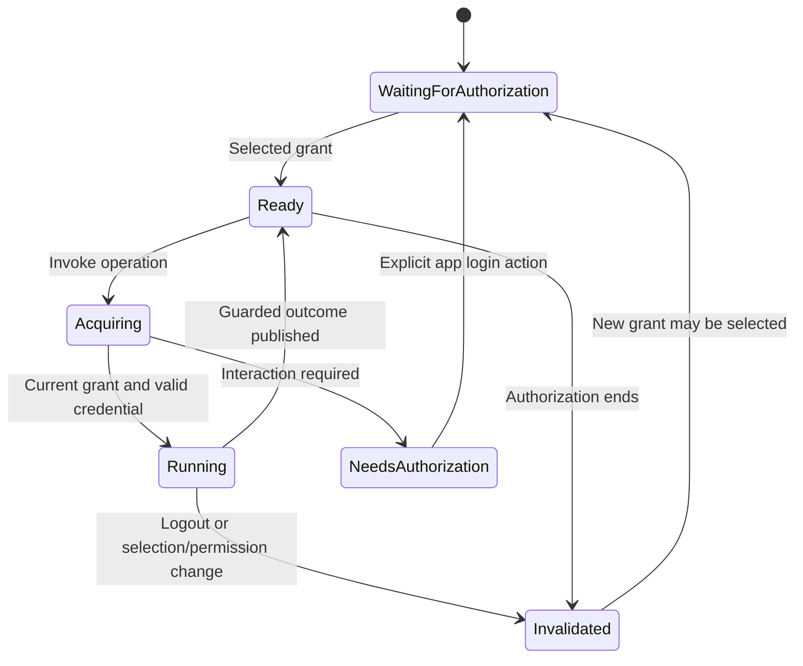

# Architecture proposal

Historical design exploration. Implementation now exists; use [the implemented contract](implementation.md), the [README](../README.md), and function help for the current API. Some options below were superseded by native connection reuse and direct-function tasks.

Status: design draft, reviewed 2 October 2026. Function names in this document are proposed unless explicitly attributed to an existing package. No backend has been tested live as part of this research.

The shinyOAuth source reviewed was the clean local development checkout at commit `4390fe226e76f10de7fd84b2bc152607c521ffe3`, declaring version `0.6.1.9000`. Fabric/brickster snapshots are recorded in the local research report; documentation capabilities must not be confused with released-package availability.

## 1. Package purpose and scope

The package supplies the missing lifecycle between a Shiny session's current OAuth authorization and an existing R database or platform client. Its central guarantee should be:

> A supported operation uses the selected user's delegated authorization, and its result is released only to the Shiny session and authorization that initiated it.

The platform remains responsible for token validation, user mapping, grants, and policy enforcement. The package supplies valid credential routing and local ownership checks; it cannot create database permissions, make an unsupported server accept OAuth, or infer an opaque access token's audience.

The confirmed scope includes connection management and shared query/task helpers. Service-account access, ordinary passwords, and integrated Windows authentication are outside the core delegated mode. A confidential OAuth client's client secret is still allowed: it authenticates the application's authorization-code exchange and does not by itself change a user's delegated query into a service-principal query.

Operations can be reads or explicitly invoked writes with the user's remote permissions. Do not label the package read-only merely because its primary use is fetching data, and do not attempt to enforce read-only behavior with SQL-text classification. Database grants and platform permissions provide that boundary. Write helpers can be introduced after the read lifecycle is proven.

## 2. Responsibility split

| Component | Owns | Existing foundations |
|---|---|---|
| `shinyOAuth` | Browser redirects, callback validation, OIDC identity, consent, authorization records, refresh credentials, token acquisition / refresh coordination, retained connections, logout | `oauth_module_server()`, `oauth_connections_server()`, module-created `OAuthConnection` |
| `shinyOAuthDB` core | Source descriptors, session ownership, authorization selection, credential routing, connection leases, task submission, result/error publication, cancellation bookkeeping | Extract shared lifecycle patterns from existing integrations |
| `shinyOAuthDB` adapters | Credential-to-driver mapping, endpoint binding, prerequisite checks, capabilities, optional user-identity probes | Existing public client hooks |
| Existing R clients | DBI execution, SQL dialects, parameter binding, platform requests, pagination, statement polling, data conversion | `DBI`, `odbc`, `RPostgres`, `brickster`, `fabricQueryR`, `dbplyr` |
| Database / platform | Access-token acceptance, database-user mapping, privileges, roles, row/column policies, audit | Vendor-specific configuration |

Do not introduce a new DBI driver or wrap every DBI generic in v0.1. Return native connections inside scoped callbacks so their established DBI methods and dbplyr translations continue to work. DBI already specifies connection/result objects, binding, cleanup, and transactions; use those conventions rather than inventing another SQL execution system. [DBI specification](https://dbi.r-dbi.org/articles/spec.html)

## 3. Four shared objects

### Source descriptor

An immutable-by-convention, validated S3 record created outside `server()`. It contains no credentials or live connections:

```text
source_id; adapter_id; label
endpoint policy: exact host/base, port, database/workspace/account, TLS policy
auth requirement: provider family, declared target name, resource identifier,
                  requested scopes, actual operation requirements
native configuration: driver, warehouse, catalog, schema, conversion settings
capabilities: native DBI, token callback, connect-time auth, query types,
              binding, cancellation, transactional support, worker execution
```

A source is reusable across users; its authenticated runtime is not. Preserve resource identifiers literally, including meaningful trailing slashes. Host normalization and OAuth-resource normalization are different problems.

### Session handle

A small R6 object created once per source inside `server()`. It binds the descriptor to a **reactive function returning a module-created `OAuthConnection`** and the owning root Shiny session. It owns connection leases, task bookkeeping, and a monotonically increasing local epoch.

The core accepts both the single-login module and the retained-authorization manager through this one interface. Selection of a manager connection is explicit when several authorizations exist. A connection ID is an opaque correlation value, not a transferable authorization capability.

### Private credential material

A short-lived internal snapshot for an operation or worker, containing a bearer credential, the source's endpoint policy, selected target, required operation scopes, acquisition timing, conservative usable-until bound, and authorization correlation. Printing excludes the credential. No refresh token, OAuth client secret, OAuth module, retained connection store, or Shiny session crosses this boundary.

A direct token and an exchanged vendor token are distinct credential stages. Token exchange, when an adapter needs it, must explicitly declare its issuer, exchange endpoint, output audience, identity mapping, and expiry rules. It is not generic token forwarding or an implicit switch to application credentials. The current bridge can export target access tokens through the public accessor. Federation recipes requiring a raw ID token or another JWT subject-token kind remain extension tracks until a validated public subject-token interface exists; `identity()` exposes selected identity claims, not the original ID token.

### Operation / task

An operation describes SQL plus parameters or a supported platform function plus plain arguments, and an explicit effect contract (`read`, `write`, or `unknown`). A query function's name does not prove absence of side effects. A task runs the same lifecycle asynchronously and exposes reactive status and a guarded result. It owns an invocation ID and an outcome envelope; it does not own consent or refresh credentials.

Use S3 for configuration/operation records and R6 for stateful handles/tasks. This is a proposed routine implementation choice, matching the lifecycle shape already present upstream. S7 offers stronger typed descriptors but adds another public type dependency with little benefit for the initial bridge. Existing S7 `shinyOAuth` objects pass through their public methods without inspection of their private state.

## 4. Public authorization boundary

The inspected `shinyOAuth` development checkout already has the necessary public interface:

- `auth$connection()` or `auth$connection(connection_id)` obtains an authorization-pinned reference.
- `connection$access_token(required_scopes, min_valid_for, force_refresh, async, target)` exports a checked bearer credential, coordinating refresh when needed.
- `connection$id` survives ordinary refresh and changes on authorization replacement.
- `connection$has_scopes(scopes, target)` checks retained operation permissions without acquiring a token.
- `connection$targets()` reports per-target status and scope evidence.

See the local [OAuthConnection implementation](../../shinyOAuth/R/classes__OAuthConnection.R), [single-module factory](../../shinyOAuth/R/connection_module.R), and [external-integration vignette](../../shinyOAuth/vignettes/external-integrations.Rmd). Require module factories for the unified integration. The legacy `oauth_connection(client, token_reactive)` wrapper follows tokens across logins and does not supply coordinated acquisition, so it does not satisfy the proposed authorization-pinned contract.

Acquire at operation start, recheck ownership after async acquisition, and hand the adapter only the credential needed for that operation. The core must propagate documented access-error reasons rather than silently opening another login or choosing a different grant. Only explicit application UI initiates reauthorization.

Do not add a second OAuth cache, refresh controller, consent store, or login UI. Optional convenience functions may assemble a `shinyOAuth` client configuration and source-specific login labels; they still delegate to the existing modules.

### Multi-resource access

Keep a token target separate from a data endpoint. Several SQL databases can use the same SQL resource token while having different grants. Fabric DAX and GraphQL share a Power BI token target while retaining separate endpoints and operation requirements. Snowflake External OAuth often uses a custom registration/resource. Databricks Entra, Databricks OAuth, and federated tokens require distinct profiles.

One Shiny login can supply several Microsoft targets where the registration, consent, and provider support that arrangement. It cannot turn a Graph token into a SQL token. Other providers or registrations may require separate authorizations. Current `shinyOAuth` target mode is explicitly provider-dependent (`microsoft` or RFC 8707); do not assume a multi-resource refresh works for every provider. Microsoft resource tokens and consent rules are described in [resources and scopes](https://learn.microsoft.com/en-us/entra/msal/javascript/browser/resources-and-scopes) and [scope/consent documentation](https://learn.microsoft.com/en-us/entra/identity-platform/scopes-oidc).

Prefer explicit delegated permissions in built-in Microsoft profiles. Offer static `.default` configuration only as an explicit profile variant with actual returned permission checks. `.default` describes a consent request, not a granted operation scope. Current `shinyOAuth` rejects mixing static `.default` and explicit API permissions in one Microsoft client's API scopes. Its Microsoft tokens cannot be narrowed by a refresh-scope request; backend/user grants and app registration choices remain important.

### Credential metadata gap

The public accessor returns a string, not a token object. `summary()` reports the default target's expiry; `targets()` does not report each target's expiry. **Do not use the default target's expiry for a SQL/Snowflake/etc. worker token, and do not decode a token's unverified JWT payload to claim a verified lifetime.**

For v0.1, record the time immediately before calling `access_token(min_valid_for = budget)`, with budget covering the planned operation and transport/clock margin. A successful accessor guarantees more than that budget remained at its recorded-expiry check; `acquisition_started_at + budget` is therefore a conservative local credential deadline. Remote revocation can reject the credential earlier. Deduct elapsed acquisition/queue time and a margin, synchronize host/worker clocks, and reject dispatch after that deadline. Reacquire after a long queue rather than exporting a snapshot at enqueue time. This intentionally sacrifices some usable lifetime.

Deadline enforcement is a declared adapter capability: dispatch-only, per-request, or whole-operation. Apply remaining-time checks and upstream timeouts at every supported phase; do not claim a universal whole-operation deadline when an upstream engine lacks a total polling/fetch timeout. Signed result downloads can have a separate capability lifetime. Completion after a configured task deadline is discarded locally, with cancellation attempted where supported. Extending engine timeout hooks belongs upstream, and is a release gate for stronger deadline claims.

A possible later improvement is a **generic** `shinyOAuth` credential-metadata accessor returning the selected target's credential and validated expiry together. That is an upstream API proposal, not an existing method or a prerequisite for the draft. It would contain no database logic. A worker's cancellation/result guard never guarantees immediate remote revocation of a bearer token already issued.

## 5. Adapter contract

Adapters should be small, capability-driven functions. Start with package-owned adapters and an experimental extension constructor after their contracts are stable; avoid a mutable global registry or plugin discovery on the authentication path.

| Hook | Inputs / result | Required behavior |
|---|---|---|
| `validate_source()` | Static descriptor -> validated descriptor | Reject ambiguous endpoints, credential fields, unsupported auth modes, insecure TLS overrides, missing required target configuration |
| `requirements()` | Descriptor + operation -> target/scopes/budget | Declare requirements before acquisition; no resource inference from arbitrary SQL |
| `credential_transform()` | Optional acquired user credential -> vendor credential | Explicit configured exchange only; bind identity/audience/expiry; no service fallback |
| `open()` | Descriptor + private credential/provider -> native handle or client context | Use public upstream token hooks; bind credentials to this exact endpoint |
| `close()` | Native handle/context | Idempotent cleanup; release results before physical disconnection |
| `query()` | Native handle + SQL/params/options -> data | Delegate to DBI/upstream; preserve type semantics and real binding |
| `call()` | Native context + supported platform operation -> value | Reuse upstream function; enforce service/endpoint requirements |
| `cancel()` | Native handle/query ID | Report real support and acknowledgment; best effort only |
| `identity()` | Optional native context -> diagnostic principal/role | Explicit user-triggered diagnostic; no query result includes identity by default |
| `worker_material()` | Descriptor + credential + operation -> plain payload | No closures retaining session state; credential never embedded in an error |

Capabilities are explicit: `native_dbi`, `sql`, `parameters`, `transactions`, `refresh_at_request`, `authenticate_at_connect`, `cancel`, `deadline_enforcement`, and `async_strategy`. They distinguish unsupported features from failure. Expose these through `oauth_db_capabilities(source)`; do not pretend GraphQL, OneLake, or KQL supports DBI transactions. The current brickster REST-backed DBI driver also reports no transaction support despite its native DBI classes.

Pin endpoint policy before acquiring credentials. For DBI, reject caller-supplied DSNs, connection strings, UID/password/authenticator overrides, redirect destinations, or connection attributes that can override that policy or activate an alternate credential source. Adapter-owned fields still supply the required user/role or OAuth authenticator. Snowflake must reject inherited `TOKEN_FILE_PATH`: the driver's documented precedence can let a token file replace the supplied `TOKEN`. For HTTP-backed clients, preserve their existing host/base policies and validate every service/poll/result destination. Platform-approved signed result URLs need their upstream-specific handling, not blanket bearer forwarding.

Sender-constrained DPoP/mTLS tokens cannot be reduced to a bearer string for ordinary drivers. The existing accessor rejects these exports. A future bound-transport adapter could use `connection$request()` or a compatible client; v0.1 bearer adapters report the documented unsupported-token-binding reason.

## 6. Physical connections versus HTTP clients

| Lifecycle | Examples | Handling |
|---|---|---|
| Authentication at physical connection establishment | SQL Server ODBC, PostgreSQL, Snowflake ODBC | Acquire before opening; the bridge bounds this lease locally; refresh cannot replace the authenticated database principal on a live connection |
| Per-request credential callback | brickster REST and its REST-backed DBI, Fabric HTTP functions | Callback resolves the pinned authorization on the main process; each request uses its matching target |
| Fixed token on a worker | Both kinds in an async worker | No refresh credential; bounded requests, worker-local creation/cleanup, staged continuation for longer work |

Default physical-connection policy: **one DBI handle per managed operation**, disconnected on success and failure. This makes async behavior and authorization replacement reviewable without adding an R pooling subsystem. Confirm native ODBC driver/manager pooling is disabled in the initial supported deployment, or prove its identity partitioning and revalidation separately: `dbDisconnect()` can return a physical connection to a native pool. ODBC pooling is a process/environment-level setting, not a proposed per-connection R keyword. [Microsoft driver-manager pooling](https://learn.microsoft.com/en-us/sql/odbc/reference/develop-app/driver-manager-connection-pooling?view=sql-server-ver17)

Physical sessions can survive their opening token's expiry; expiry and remote permission/revocation timing are backend-specific, and a local lease deadline does not change those server rules. Reuse an upstream stateless client/provider where it is safe; it does not have the same cost as a physical SQL connection.

Provide opt-in `connection_policy = "session"` for native connections after live validation. Reuse is restricted to the owning session, authorization epoch, endpoint/configuration, role, and credential lease. Check current authorization and requested permissions before checkout; retire expired or replaced idle leases, and do not add bridge-level reconnect in the middle of a transaction. A busy lease cannot be concurrently shared. Connection replacement can occur for the next operation, never as automatic replay of a previous statement.

Native clients can have their own reconnect behavior. The inspected RPostgres connection code may call `PQreset()` while creating a new result; a per-operation scope alone cannot prevent this during a transaction. Test interrupted-transaction/commit behavior and any available reconnect controls before claiming managed transaction guarantees. Arbitrary native callbacks retain upstream limitations; the bridge must not promise stronger atomicity merely because it owns the lease. [RPostgres connection source](https://github.com/r-dbi/RPostgres/blob/main/src/DbConnection.cpp), [result source](https://github.com/r-dbi/RPostgres/blob/main/src/DbResult.cpp)

Do not begin with a global `pool::dbPool()` across users. A future pool could be partitioned by authorization and worker/session ownership, bounded in size, and supplied with current credentials on creation; this is a separate optimization. `pool` automates lifecycle but does not establish user-identity partitioning for this package. [pool project](https://github.com/rstudio/pool)

Native DBI/dbplyr compatibility uses a scoped callback. The callback may materialize data or return an ordinary value; a live `DBIConnection`, `DBIResult`, cursor, or lazy dbplyr table cannot escape a per-operation lease or worker. dbplyr lazy tables execute later, so `collect()` must occur inside the managed operation. [dbplyr lazy queries](https://dbplyr.tidyverse.org/reference/tbl.src_dbi.html)

Trusted application code can capture a raw connection or use an exported token outside a callback. A scope helper cannot prevent that; document this as outside the managed guarantee. The higher-level query/task APIs avoid requiring such captures.

## 7. Shared operation lifecycle

1. Validate source and operation configuration. Evaluate reactive arguments in the main Shiny session.
2. Resolve the selected authorization and capture session binding, connection ID, local authorization/permission epoch, source/configuration ID, and invocation ID.
3. Verify declared operation requirements; acquire only the required target token through `shinyOAuth`. An unacquired target is not evidence of denied permissions: `has_scopes()` returns FALSE before its first token exists. Let `access_token()` perform initial acquisition and its authoritative checks rather than blocking first use on that FALSE.
4. After acquisition, verify the captured authorization and requirements again. Never substitute a newer login for the captured one.
5. Open or check out the native connection/context; verify credential and request deadlines before dispatch.
6. Execute through the established client. Parameter values use real driver binding; identifiers use driver quoting or predefined server-side query templates.
7. Always clear results and close/return the lease. For async work, produce a success **or failure** envelope instead of raising a worker error directly into a UI output.
8. Before publication, check the envelope against current ownership, source selection, authorization epoch, invocation policy, and required permissions. Apply the same gate to data, errors, progress, downloads, and exports.

An ordinary token rotation is not a new authorization epoch. Avoid dependencies on access-token bytes or normal expiry changes in data reactives. `shinyOAuth` already separates authorization/permission dependencies from token rotations. Use its factory and scope checks, not its raw reactive token slot.

A permission epoch changes on observed loss of relevant local grant coverage, even if the connection ID does not. Observe the public connection factory and operation-specific `has_scopes()` checks; do not derive permission epochs from `targets()` expiry/refreshing status, which changes during routine credential rotation. An initial `not_acquired` -> acquired transition is not permission loss and must not invalidate its own first operation. At minimum, require operation scopes again on publication; permanently retire session results when previously covered requirements cease to be covered. A result produced before an observed permission loss must not reappear merely because those permissions return later. Source selection and observed permission loss increment the local epoch even if the authorization ID is unchanged.

Remote grants may change without a local OAuth signal. A server authorizes fresh requests; already-fetched data or an established connection may have different revocation timing. Default to no cross-operation query cache and explicit refresh. An optional session cache needs authorization/permission/source/role/query keys, TTL, explicit invalidation, and no reuse across reauthorization. Avoid application-wide Shiny caches for protected user data. [Shiny cache scope](https://pkgs.rstudio.com/shiny/reference/bindCache.html)

### State and outcome model



`ready` means local configuration/authorization is suitable for acquisition, not a proof of remote database access. A stale outcome is discarded, including its error text; diagnostics may record a redacted discard event. On invalidation, clear server-held results and emit an empty/unavailable UI state. Data already downloaded or displayed cannot be recalled.

## 8. Nonblocking execution

Use `shiny::ExtendedTask` as the internal task lifecycle, with `promises` and a configured `mirai` or non-sequential `future` backend for blocking database work. A promise alone does not move synchronous DBI work off the main R process. ExtendedTask provides same-session responsiveness and serializes its own invocations. Create handles/tasks inside `server()` and configure worker infrastructure once outside it. [Shiny nonblocking operations](https://shiny.posit.co/r/articles/improve/nonblocking/)

The public task is a guarded wrapper, not the raw ExtendedTask. It captures authorization correlation at invocation; when a queued invocation actually begins, it reacquires a current token **for that captured grant**, validates it, and then submits the worker payload. It drops invalid queued work. Offer latest-pending coalescing only when trusted application configuration explicitly declares `effect = "read"`; in-flight read outcomes can be invalidated by invocation ID when a newer result should replace them. The default for unknown or write effects is serial, never coalescing; no SQL-text classification supplies this declaration. A serial policy is also available when every read invocation matters.

Workers receive plain source configuration, operation arguments, correlation fields, and short-lived credential material. They create and close their own native connection. DBI connections cannot safely be exported to another process. Return data frames or another explicitly serializable value; Arrow external-pointer objects need a supported IPC conversion before transfer. [Future non-exportable objects](https://future.futureverse.org/articles/future-4-non-exportable-objects.html)

Provide built-in SQL operations and package-owned platform wrappers first. A custom asynchronous operation must be a resolvable package function or an explicitly approved worker function with plain dependencies. Do not silently erase an arbitrary closure's environment to make serialization work, and do not export a closure retaining Shiny state. Synchronous callbacks can close over ordinary app values because they execute in the owning session.

For long-running REST statements, obtain the server statement ID through the upstream client. A later phase may acquire a new access token on the main process and resume polling/fetching that **same** statement, subject to ownership checks. This avoids retaining refresh tokens in workers or resubmitting a statement. v0.1 may instead bound such operations and report expiration; staged continuation is an explicit capability, not an assumption.

Cancellation has three separate effects: stop publishing a local outcome, request remote cancellation if supported, and release local resources. An invalidated worker may already have sent an authorized query. After logout, the pinned OAuthConnection cannot necessarily reacquire credentials: cancellation may use only still-valid captured operation credentials where supported, never a replacement login. Keep statement IDs server-side and report unacknowledged cancellation. A cancellation timeout/unsupported driver cannot promise that server execution stopped. Per-operation deadlines, bounded queues, per-session concurrency, and native cancellation support contain costs without claiming stronger revocation.

## 9. Errors, retries, and diagnostics

Stable errors should distinguish configuration, missing adapter dependency, unsupported authentication, unavailable authorization, insufficient operation scopes, interaction required, credential deadline, remote permission denial, transport failure, statement failure, unsupported operation, cancellation, and invalidated outcome.

Preserve `shinyOAuth_access_error` reasons where available. Adapters may retain sanitized upstream condition classes, SQLSTATE/status codes, and correlation IDs on the server. Do not attach tokens, full connection strings, raw response bodies, SQL parameter values, or the original worker condition/environment to browser-facing errors. Successful query data still follows the normal guarded publication path.

Delegate documented safe polling/backoff to platform engines, but audit their behavior. Acquiring a credential does not authorize automatic replay after a failed SQL statement or HTTP operation. A 403 is generally an authorization/setup problem, not an invitation to refresh. For an ambiguous timeout or lost connection after submission, preserve an unknown-outcome error or the existing statement ID; do not resubmit automatically. Any upstream retry must be safe under its documented request semantics.

Expose redacted events for acquisition, connection creation/reuse/retirement, query dispatch/completion, invalidation, and cancellation. Optional explicit identity diagnostics inspect backend-specific principal and role queries alongside server/audit evidence of the credential's subject. PostgreSQL `current_user` may be a mapped group role; it need not equal the person's email. These diagnostics are useful for live acceptance tests; they do not replace the remote policy engine.

## 10. Adapter priorities and release policy

Prioritize Fabric and Databricks migrations, the shared SQL Server token-injection code for Azure SQL, and Azure PostgreSQL. Add Snowflake after proving explicit OAuth credentials take precedence over any helper or ambient authentication. Conditional on-premises Entra SQL can share the SQL Server transport; its provisioning instructions must remain distinct.

Keep native PostgreSQL OAuth, BigQuery, Redshift/Athena trusted identity propagation, and other services as documented extension tracks until the R interface and identity isolation are proven. A platform supporting OAuth does not imply its current R driver supports safe per-user token injection. The research reports identify these specific gaps.

Support labels should be `implemented and integration-tested`, `implemented experimental`, `documented feasible`, and `unsupported configuration`. This repository currently uses only the last two where appropriate. Include tested package/driver/server versions in future adapter release notes. Do not set a minimum version solely from the latest documentation site's version label.

## 11. Chosen tradeoffs and remaining validation

| Choice | Recommendation | Alternative and cost |
|---|---|---|
| Package scope | Thin adapters + shared session/task lifecycle | Credentials-only is smaller but repeats lifecycle work in every app |
| DBI strategy | Native clients inside managed scopes | New proxy DBI driver expands maintenance and dbplyr compatibility work |
| Async strategy | Shared guarded tasks; worker-local native connections | Platform-specific async code repeats stale-outcome and cleanup logic |
| Physical reuse | Per operation first; opt-in per session later | Partitioned pools improve latency but require more identity/lifetime machinery |
| Authentication convenience | Reuse existing auth module; optional configuration planner | Another top-level login wrapper obscures multiple providers/registrations |
| Extension mechanism | Explicit adapters and capabilities | Global registration/discovery adds mutable state and support ambiguity |
| Unsupported identity paths | Actionable unsupported error | Service identity changes the authorization guarantee and is outside the confirmed scope |

The remaining uncertainties are concrete validation work: Snowflake explicit-token precedence; exact supported SQL scope/resource variants; package release availability of the inspected fork hooks; native RPostgres OAuth callbacks; BigQuery isolated credentials; and platform-specific policy behavior. They should gate adapter claims, not block the shared architecture. See [migration plan](migration-plan.md) for acceptance criteria and [API draft](api-draft.md) for the proposed developer interface.
