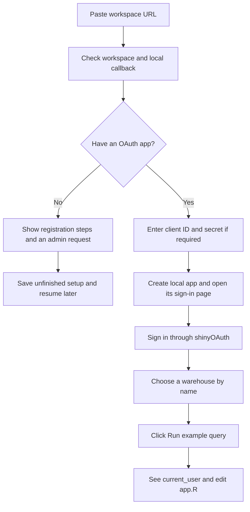

# Guided cloud demos

Implementation notes for the cloud guides. The package exports
`oauth_db_cloud_demo("databricks")`; see the
[getting started guide](../vignettes/getting-started.Rmd#more-ways-to-try-an-app)
for the launcher workflow and the source guides for platform settings and limits.
Fabric, BigQuery, Snowflake, Azure SQL, Azure PostgreSQL, Redshift and
ClickHouse now use the same saved-draft and console runner, with their own
field help, registration steps and editable connection/query files.
The original `cli` design preview remains available:

```sh
Rscript --vanilla tools/preview-cloud-demo.R ready
Rscript --vanilla tools/preview-cloud-demo.R registration
```

The preview uses fictional inputs and simulated outcomes. It doesn't
collect credentials, open a browser or contact a workspace.

## Purpose

Help an R user turn their existing cloud workspace into a small, editable
Shiny example. They should understand where to find each setting and see
that queries run as the person who signs in. The cloud platform keeps
enforcing their existing permissions.

The guide is for the R user creating the app. People visiting the finished
app only sign in through their browser; they don't enter app-registration
details. Treat registration as a reusable organization setup. For a local
demo, prefer a public PKCE registration when policy allows it, so colleagues
can reuse its client ID without distributing a client secret.

Databricks uses workspace OAuth on AWS, Azure and GCP where custom
registration is available. Fabric, the Azure databases, Redshift and
ClickHouse examples use the existing Entra helpers. BigQuery uses a Google
Web client, and Snowflake uses its own confidential custom-client integration.

## Entry point

Public entry point:

```r
shinyOAuthDB::oauth_db_cloud_demo("databricks")
```

This starts a console guide, prepares an editable app and runs it locally.
An optional `path` keeps the app for later runs. Supplied configuration
skips the corresponding prompts; noninteractive calls report missing
values instead of waiting for input.

Keep this separate from `oauth_db_demo()` initially. The cloud demo uses
the person's existing service; there is no database to start in Docker.
This also avoids making the existing `app = "docker"` default mean
something different for cloud providers.

## Ask for as little as possible

| Setting | Guide behavior |
| --- | --- |
| Workspace URL | Paste the address from the workspace browser tab. Accept a full workspace URL and extract its HTTPS origin. Explain the difference if they paste an account-console URL. |
| OAuth app client ID | Ask whether they have an app registration. Offer a short setup panel and an administrator request if they don't. |
| Client secret | Ask only for a confidential registration. Use masked input or a provider-specific environment variable. A public registration uses PKCE without a secret. |
| SQL warehouse | Discover names after browser sign-in. A manual warehouse ID or HTTP path remains an optional fallback. |
| Callback address | Supply a fixed local address, initially `http://localhost:8100`. Check the port before showing registration instructions. |
| Catalog, schema and table | Omit these from initial setup: the first query needs no table. |

An administrator registers the custom OAuth app under account-console
**Settings > App connections**. The guide supplies the callback and asks
for SQL access. Databricks supports public and confidential registrations;
a confidential client needs its secret. See the
[registration instructions](https://docs.databricks.com/aws/en/integrations/enable-disable-oauth)
and [registration fields](https://docs.databricks.com/api/account/customappintegration/create).

Use `openid`, `profile`, `email`, `offline_access` and `sql` for the pilot.
The SQL scope covers warehouse listing and statement execution, so the
demo needn't default to `all-apis`.
[Databricks SQL scopes](https://docs.databricks.com/api/workspace/scopes)
describe those operations. Scope selection doesn't grant table privileges
or make an account read-only.

## The first-run journey



The console explains the next action before asking for a value. Each
prompt offers help, back and cancel. A registration panel gives the exact
callback and a short request the user can copy to their administrator;
the helper doesn't send that request or create an app registration.
Explain that the client ID identifies the app, and that a SQL warehouse
runs its queries, before asking users to find those settings. Check the
required R packages first and offer an installation command for any that
are missing.

Check the workspace's OIDC metadata without credentials, with a short
timeout. Report URL mistakes separately from DNS, VPN, TLS and access
failures. Show only the normalized origin, never URL query parameters.

Sign-in happens through the generated Shiny app and shinyOAuth. Avoid a
separate CLI login that would authenticate only the person running R.
After sign-in, use the visitor's authorization to list warehouses through
the API client. Show names and current states, with a manual-ID option.
The [list endpoint](https://docs.databricks.com/api/warehouses/v1/warehouse)
returns visible warehouses; a listing alone doesn't prove query permission.

The app then shows the fixed query and a **Run example query** button:

```sql
SELECT current_user() AS signed_in_user
```

Explain beside that button that running SQL can start a stopped warehouse
and incur normal compute charges. Databricks documents this
[automatic start behavior](https://docs.databricks.com/aws/en/compute/sql-warehouse).
Do not connect through DBI or submit SQL just because someone signed in.
Use an explicit button and no polling or automatic query replay.

Create the DBI helper after the visitor chooses a warehouse and keep that
choice fixed for that sign-in. A new sign-in resets warehouse selection
and query output. This fits the current helper's fixed warehouse ID
without adding reactive warehouse parameters to the public API.

Show the returned database identity and explain why it matters: this
visitor's data permissions apply to later queries too. The user can then
edit the generated `app.R` to query their own tables. Keep a free-form SQL
console and sample-table selection out of the first version.

## Console and app responsibilities

| Console, formatted with `cli` | Generated Shiny app |
| --- | --- |
| Explain the example and collect configuration | Sign in and sign out using shinyOAuth |
| Show where to find settings and registration help | List warehouses using the signed-in visitor's token |
| Validate local input, reachability and dependencies | Show the query before execution and display its result |
| Print the editable app path and resume command | Clear selections and results when authorization changes |
| Offer a setup-only exit when registration is missing | Offer setup help and a way back to the console guide |

Use `cli_h1()` for the guide title, `cli_h2()` for steps, wrapped alerts
for validation and `cli_progress_step()` for real network checks. Use
`cli_code()` for commands and copyable snippets. See
[cli headings](https://cli.r-lib.org/reference/cli_h1.html)
and [alerts](https://cli.r-lib.org/reference/cli_alert.html).

`cli` formats messages; it doesn't provide text entry or masked passwords.
Use `readline()` and numbered menus for ordinary prompts, and a masked
helper such as `askpass::askpass()` for secrets. If masked entry isn't
available, offer an environment-variable route instead of visible input.

## Failure and recovery

| Situation | Next step |
| --- | --- |
| No app registration or no account-admin access | Keep the non-secret draft and show a copyable administrator request. Resume when the client ID is available. |
| Local port is occupied | Choose another port before registration, then show the exact callback to register. Never silently change it after registration. |
| Browser reports a redirect mismatch | Compare the registered callback with the displayed address, including its path and trailing slash. Offer a return to setup. |
| Provider rejects the client or scopes | Explain which registration setting to check; don't print the submitted secret or automatically broaden scopes. |
| Registration was just created | Explain that provider changes may take time; offer a manual retry, not a long hidden retry loop. |
| No warehouses are listed | Show where to find SQL Warehouses and how to request access. Allow a known warehouse ID or HTTP path. |
| Warehouse is visible but query is forbidden | Explain warehouse CAN USE separately from catalog/schema/table permissions. Keep successful sign-in intact. |
| Query is slow or fails | Keep its status and provide an explicit retry. A failed HTTP response doesn't prove the query never ran. |
| User signs out or switches account | Clear data and warehouse choices; retire the previous authorization and connection. |

## Files and credentials

Generate a readable `app.R`, a small non-secret settings file and a short
README with restart instructions. Use a persistent, platform-specific
directory in R's user cache by default, so pausing survives restarting R.
An explicit `path` supports separate projects. Keep existing user edits
and refuse unrelated nonempty directories. Back to setup offers a numbered
menu of saved values; changing one value preserves unrelated settings.
Changing the OAuth issuer requires a matching client registration.

Keep access tokens in shinyOAuth's session lifecycle. Do not use saved
Databricks CLI tokens, request passwords or PATs, or substitute a shared
service principal for the visitor. Read a confidential secret through
masked input or `OAUTHDB_DATABRICKS_CLIENT_SECRET`; keep it out of command
history, console transcripts and generated files. Persistence in an OS
credential store can be an explicit later option.

Run the app with the user's installed R packages, using normal cloud TLS
trust. The processx runner inherits the environment and installed library paths.
It passes a confidential secret only through the child environment, keeping
it out of serialized arguments and generated files. It does not reuse the
Docker launcher's demo CA configuration. A native-process canary checks
credential transport without recording the credential.

Stopping the demo closes its local app and connections. It doesn't stop
or delete a shared warehouse, change auto-stop settings, create cloud
resources or grant permissions.

## Implementation boundaries and checks

Platform descriptors supply field validation, console help, registration
steps, dependencies and readiness checks. The Databricks guide keeps its
warehouse selector and uses `oauth_db_databricks_client()`,
`oauth_db_databricks_api()` and `oauth_db_databricks()` with explicit SQL scopes.
The other templates call their existing public clients and database/API
helpers. Existing client defaults stay unchanged.

Warehouse discovery follows pagination through a guarded HTTP adapter. The
[brickster list helper](https://databrickslabs.github.io/brickster/reference/db_sql_warehouse_list.html)
has no page-token argument in its documented interface. The new API
method follows page tokens with an overall deadline and rejects cycles.

Validation covers prompt validation, help/back/cancel,
resuming incomplete setup and preserving edits. The browser fixture uses
real Keycloak sign-in with simulated Databricks warehouse and SQL responses.
It checks warehouse selection, account separation, connection cleanup and
the absence of implicit SQL or credentials in generated files.
Registration, SQL-only scope compatibility and the full browser flow in a
real Databricks workspace still need validation in an account supplied
for that test. Local OAuth fixtures and mocked Databricks calls don't
establish real-workspace compatibility.

The Databricks app keeps its warehouse selector. The seven other apps share
an editable `demo-ui.R`, while `app.R` shows each platform's client, connection
and query code. Redshift and ClickHouse use Entra as a concrete trusted-token
example and pause early when the deployment isn't configured. Broader manual
provider configuration remains in their platform vignettes.

The browser fixture now accepts a platform name and substitutes local Keycloak
and database responses. Its named token targets exercise the shared UI with
the real OAuth session lifecycle. It doesn't validate a real cloud account,
plan eligibility, native cloud drivers or administrative configuration.
